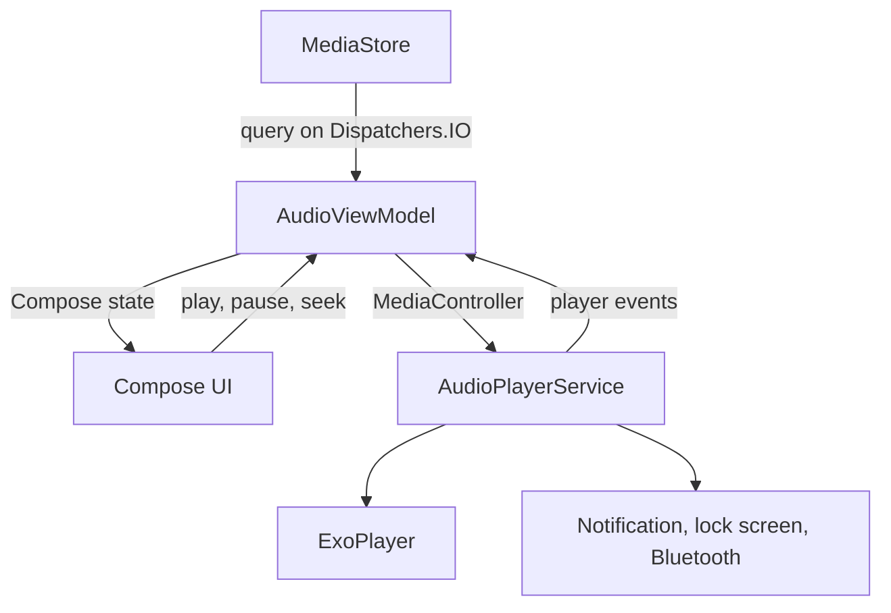

# Basic Audio Player

A small, offline music player for Android. It lists the music stored on the phone and
plays it in the background, with the notification, lock screen and Bluetooth controls
Android users expect. The UI follows the Google Pixel look: Material You colors from the
wallpaper, the Pixel "squiggly" seek bar and a play button that changes shape.

Kotlin, Jetpack Compose (Material 3) and AndroidX Media3 (ExoPlayer). Android 6.0+.

## Features

- **Library**: every music file MediaStore knows about, with title, artist and duration,
  sorted by title using the phone's language rules. Refreshed whenever the app comes back
  to the foreground.
- **Background playback** through a Media3 `MediaSessionService`: media notification,
  lock screen, Bluetooth and headset buttons. Tapping the notification reopens the app.
- **Well-behaved audio**: takes audio focus (pauses for calls and other apps), pauses
  when headphones are unplugged, gapless between tracks, and starts (or resumes after a
  seek) as soon as a quarter second of audio is buffered.
- **Pixel look**:
  - Material You dynamic color from the wallpaper on Android 12+, with a matching
    fallback palette (generated from Pixel's default blue seed) on older versions.
  - Light and dark mode following the system.
  - Google Sans, read from the system on Pixel phones (nothing is bundled).
  - A wavy seek bar that flows while playing and flattens when paused, and a play button
    that morphs from a circle into a rounded square, as in the Pixel media controls.
  - Grouped, rounded list rows as in Android 16 settings, and a themed (monochrome)
    launcher icon.

## Project layout

Everything lives in `app/src/main/java/.../ui/activitys/`:

| File | What it does |
| --- | --- |
| `AudioPlayerService.kt` | Owns ExoPlayer and the `MediaSession`. Media3 does the notification and controls. |
| `AudioViewModel.kt` | Queries MediaStore, connects one `MediaController` to the service and mirrors the player as Compose state. |
| `MainActivity.kt` | The activity, the permission flow and the track list. |
| `NowPlaying.kt` | The docked player card: artwork, wavy seek bar, play/pause and skip buttons. |
| `Theme.kt` | Material You colors, fallback palette and Google Sans typography. |



## Where the efficiency comes from

The app is small, so most of the work is in not doing things.

**The playing position never recomposes the UI.** While music plays, the position is
refreshed about 30 times a second, and the wave moves with it. The position is read inside
the seek bar's `Canvas` draw lambda, so a change only redraws that one canvas; Compose
skips composition and layout. The elapsed-time label sits in its own small composable
behind `derivedStateOf`, so it recomposes once per second. The position comes from
`MediaController.currentPosition`, which is extrapolated locally from the last player
update, so reading it costs no IPC. Thirty updates a second keeps the wave smooth while
drawing a quarter of the frames a 120 Hz screen would. The loop stops by itself in the
background, because Compose pauses its frame clock when the activity is stopped.

**One controller, connected once.** The `MediaController` lives in the ViewModel, so it
survives rotation and is released in `onCleared`. Player state arrives through a single
`onEvents` listener that copies it into Compose state; writing an unchanged value
recomposes nothing.

**Nothing is loaded until you press play.** Opening the app does not prepare the player,
so no decoder is created and no notification appears until a song is chosen. The full
playlist is only sent to the service when it differs from what the player already holds.

**Artwork is decoded once, small.** ExoPlayer already extracts the embedded cover while
reading the file. The ViewModel decodes those bytes off the main thread at the smallest
power-of-two scale that still fits the 56dp thumbnail, instead of re-reading the file.

**Buffering is tuned for files on the phone.** By default ExoPlayer waits for a full second
of audio before it starts, and again after every seek. Files on the phone read far faster
than they play, so the app starts once a quarter second is buffered. ExoPlayer's other
local-file defaults already fit: it reads up to 50 seconds ahead in one burst (less for very
large files), then leaves storage idle until under a second is left. The device's decoder
list, which ExoPlayer would otherwise read right before the first song, is loaded in the
background when the service starts.

**Few wake-ups while playing.** ExoPlayer's dynamic scheduling (on by default) runs the
playback loop only when the audio buffer needs refilling, about four times a second,
instead of every 10 ms. The session does not push a position update to the system media
controls every 3 seconds; they work out the position themselves, and still get every seek,
pause and track change. A local wake lock keeps playback going with the screen off and is
released when paused. No audio effects are attached to the session.

**The build strips what is unused.** R8 runs with optimizations (`proguard-android-optimize.txt`)
plus resource shrinking. There is no AppCompat, no extended icon set (the six icons are
vector drawables) and no Palette library. A wildcard baseline profile marks all app code,
and all of Media3, which ships no profile of its own, for ahead-of-time compilation, so file
parsing and decoding don't start out interpreted after each install. Compose ships its own
profiles. The release APK is about 2.0 MB.

## Building

Requires JDK 17.

```
./gradlew assembleRelease
```

The APK is written to `app/build/outputs/apk/release/app-release.apk`. Unit tests run
with `./gradlew testReleaseUnitTest`.

### CI and signing

GitHub Actions builds every pull request, and every push to `master` publishes the APK
as the `latest` release.

By default CI signs with a throwaway debug key that changes on every run, so Android
refuses to install a new APK over the previous one. To sign every build with the same
key, create one once:

```
keytool -genkeypair -keystore release.jks -alias release -keyalg RSA -keysize 2048 -validity 10000
```

and add these repository secrets (Settings > Secrets and variables > Actions):

| Secret | Value |
| --- | --- |
| `SIGNING_KEYSTORE_BASE64` | output of `base64 -w0 release.jks` |
| `SIGNING_STORE_PASSWORD` | the keystore password |
| `SIGNING_KEY_ALIAS` | `release` |
| `SIGNING_KEY_PASSWORD` | the key password |

Keep `release.jks` out of the repository. The first APK signed with the new key needs
the old app to be uninstalled once; after that, updates install normally.

## Left out on purpose

- **Equalizer and bass boost.** The earlier version attached both at a fixed setting
  with no way to change them, which colored the sound.
- **Hardware audio offload.** Letting the audio chip decode saves battery during long
  screen-off listening, but only for MP3, AAC and Opus (never FLAC or WAV), and only on
  phones that support it. While offloaded, ExoPlayer sleeps until the chip asks for more
  data, with no timeout, so a lost request leaves playback silent until the next seek,
  which fits the silence seen after quick repeated seeking. It also rebuilt a 50-second
  buffer on every seek. Reliable seeking won over that battery saving.
- **Colors from album art.** The app uses the wallpaper colors instead, like other Pixel
  apps. The artwork still shows in the player card.
- **A native (C++/Oboe) audio engine.** Exclusive, low-latency audio matters for
  instruments and games, not for playing files.

## License

MIT License
